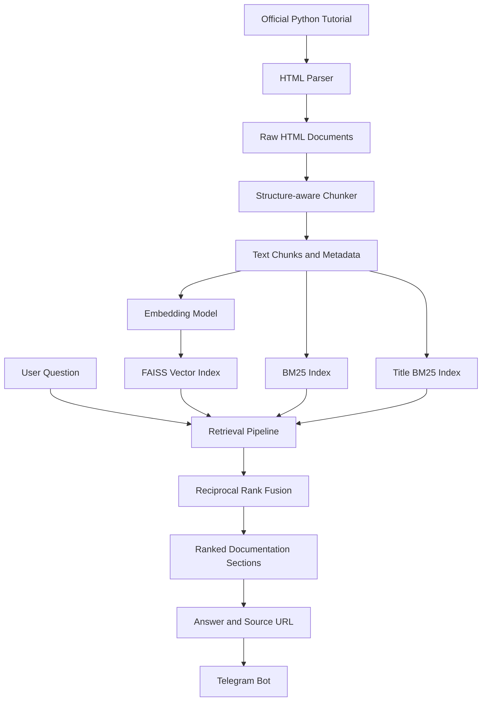

# Python Tutorial RAG

A Retrieval-Augmented Generation (RAG) system for searching the official Python Tutorial documentation. It combines multilingual semantic search, BM25 lexical retrieval, and section-title matching.

## Project Overview

The system indexes the official [Python Tutorial](https://docs.python.org/3/tutorial/) and retrieves relevant documentation sections in response to user questions.

### Key Features

- HTML documentation parsing with HTTPX and BeautifulSoup.
- Structure-aware chunking based on documentation sections.
- Multilingual embeddings using Sentence Transformers.
- Vector search with FAISS.
- Hybrid retrieval combining semantic search, BM25, and title matching.
- Reciprocal Rank Fusion (RRF).
- Telegram bot built with aiogram 3.
- Retrieval evaluation using Hit@1, Hit@3, and MRR.

## Architecture



## Retrieval Pipeline

The retrieval system combines three complementary signals:

1. **Semantic search** — finds passages with similar meaning using multilingual embeddings and FAISS.
2. **BM25 search** — retrieves passages based on lexical relevance.
3. **Title matching** — improves retrieval when query terms match documentation section titles.

The ranked results are combined using Reciprocal Rank Fusion.

### Configuration

| Parameter | Value |
|---|---|
| Embedding model | `paraphrase-multilingual-MiniLM-L12-v2` |
| Embedding dimension | 384 |
| Vector index | `FAISS IndexFlatIP` |
| Candidate pool | 40 |
| RRF constant | 60 |
| Title weight | 2.0 |
| Exact title weight | 0.01 |
| Semantic fallback threshold | 0.35 |

## Tech Stack

- Python 3.13
- Sentence Transformers
- FAISS CPU
- NumPy
- rank-bm25
- HTTPX
- BeautifulSoup4
- lxml
- aiogram 3
- python-dotenv

## Project Structure

```text
python-tutorial-rag/
├── data/
│   └── raw/
├── eval/
│   ├── questions.jsonl
│   └── eval.py
├── logs/
│   └── queries.jsonl
├── src/
│   ├── parser.py
│   ├── chunker.py
│   ├── index.py
│   ├── rag.py
│   └── bot.py
├── .env
├── .gitignore
└── requirements.txt
```

Generated indexes and downloaded data are created locally and are not committed to the repository.

## Installation

### 1. Clone the repository

```bash
git clone https://github.com/redsea1970/python-tutorial-rag.git
cd python-tutorial-rag
```

### 2. Create a virtual environment

**Windows PowerShell:**

```powershell
python -m venv venv
.\venv\Scripts\Activate.ps1
```

**Linux / macOS:**

```bash
python -m venv venv
source venv/bin/activate
```

### 3. Install dependencies

```bash
pip install -r requirements.txt
```

## Build the Knowledge Base

Run commands from the repository root in this order.

### 1. Download documentation

```bash
python -m src.parser
```

### 2. Create text chunks

```bash
python -m src.chunker
```

### 3. Build the vector index

```bash
python -m src.index
```

## Run a Search

```bash
python -m src.rag "What is a list comprehension?"
```

## Evaluation

The retrieval system is evaluated against 18 questions with expected documentation anchors.

### Run evaluation

```bash
python -m eval.eval
```

### Current Evaluation Results

| Metric | Score |
|---|---:|
| Hit@1 | 0.9444 |
| Hit@3 | 0.9444 |
| MRR | 0.9556 |
| Evaluation questions | 18 |

- **Hit@1** — whether the first result matches an expected section.
- **Hit@3** — whether at least one expected section appears in the top three results.
- **MRR** — reciprocal rank of the first relevant result.

These results apply to the current evaluation dataset and do not guarantee performance on arbitrary questions.

## Telegram Bot

The project includes a Telegram bot built with aiogram 3.

### Configuration

Create a `.env` file in the repository root:

```env
BOT_TOKEN=your_telegram_bot_token
```

Replace the placeholder with your Telegram bot token.

### Start the bot

Make sure the knowledge base has been built, then run:

```bash
python src/bot.py
```

The bot supports:

- `/start` — welcome message.
- `/help` — usage instructions.
- `/ask <question>` — ask a question.
- Regular text messages — search the documentation.

User queries are logged locally in `logs/queries.jsonl`.

## Future Improvements

- Add an optional LLM-generated answer layer with grounded citations.
- Expand the evaluation dataset and add regression testing.
- Improve retrieval for ambiguous and short queries.
- Add Docker and Docker Compose support.
- Add monitoring and retrieval-quality analytics.

## License

This project is intended for educational and portfolio purposes. Python documentation is provided by the Python Software Foundation.
